# Maritime super-resolution of Sentinel-2-scale RGB imagery

**Master's thesis code: Athanasios Papazikos.**

This repository holds everything needed to repeat the thesis experiments on **ports, harbours, coasts and open sea**. It covers the maritime training dataset, the automated image-quality check, SwinIR training at ×4 (10 m → 2.5 m) and ×10 (10 m → 1 m), validation, and prediction on real Sentinel-2 scenes.

<p align="center">
  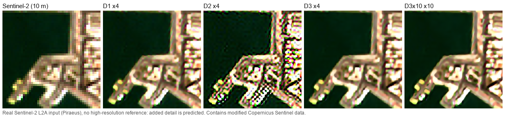
  <br><sub>A real Sentinel-2 L2A scene of the port of Piraeus, super-resolved by the four thesis models. No high-resolution reference exists for this scene, so the added detail is predicted, not observed. Contains modified Copernicus Sentinel data.</sub>
</p>

## Contents
- [What the thesis does](#what-the-thesis-does)
- [Results](#results)
- [Marine gallery](#marine-gallery)
- [Repository layout](#repository-layout)
- [Installation](#installation)
- [Pre-trained weights](#pre-trained-weights)
- [Pipeline](#pipeline)
- [Data availability and licences](#data-availability-and-licences)

## What the thesis does
- **Maritime dataset.** 18,194 high-resolution RGB tiles of maritime scenes: ports, marinas, quays, anchorages, built and natural coasts, estuaries and open sea. The tiles come from 410 sites in more than 70 countries. Each tile covers 1,280 m × 1,280 m. The sources are Maxar Open Data, Satellogic EarthView, public aerial RGB orthophotos and Planet SkySat. The splits are separated by geographic site: 17,952 train tiles, 115 validation tiles and 127 test tiles. Validation and test contain only Maxar tiles, and the test split was never used.
- **Three ways to make the low-resolution input.** Each 2.5 m HR tile (512 × 512 px) gets a 10 m LR version (128 × 128 px) in three ways. All three use the same HR targets:

  | Recipe | LR degradation |
  |---|---|
  | **D1** `d1-bicubic-aa-v1` | anti-aliased bicubic ×4 downsampling |
  | **D2** `d2-gaussian-area-context-v1` | fixed Gaussian PSF (σ = 5 m), then an exact 4 × 4 area mean |
  | **D3** `d3-variable-psf-noise-v1` | random isotropic or anisotropic Gaussian PSF (σ = 2.5–7.5 m, random angle), exact area mean, Gaussian noise (σ ≤ 2/255; none for 20 % of tiles) |
- **Jev check.** Before the ×10 dataset was built, the [TypeSafe Jev](https://typesafe.ai) vision model rated every HR tile for clouds, no-data, seams and colour artefacts. Fixed rules (v5) plus a manual review then removed 1,123 tiles.
- **D3x10.** The D3 recipe applied at 1 m HR (1,280 × 1,280 px) and 10 m LR, with the PSF kept in metres. After the Jev check it has 16,835 train, 115 validation and 121 test tiles.
- **Model.** Classical [SwinIR](https://github.com/JingyunLiang/SwinIR), trained from scratch with no pre-trained weights. It has 11.9 M parameters at ×4 and 12.7 M at ×10; the ×10 head is SwinIR's ×2 stage followed by a ×5 pixel-shuffle stage. Each model was trained for 100,000 Adam updates: learning rate 2 × 10⁻⁴ with 2,000 warm-up updates and cosine decay, batch 16, 64 × 64 LR crops, masked L1 loss, bf16, seed 42. Validation ran every 2,000 updates, and the checkpoint with the best validation PSNR is the "best" model.
- **Hardware.** D1, D2 and D3x10 were trained on one NVIDIA A100 40 GB of the AUTH Aristotle HPC cluster. D3 was trained on one NVIDIA L4 24 GB on Google Cloud.

## Results
All numbers are on the **validation split: 115 Maxar images from 6 port sites**. PSNR is computed in float64 per image on clipped RGB. SSIM uses an 11 × 11 Gaussian window. LPIPS uses AlexNet (`lpips` 0.1.4). Bicubic is the baseline for each recipe's own LR input.

| Model | Scale | LR recipe | Bicubic PSNR | **SwinIR PSNR** | Gain (95 % CI) | SSIM (bicubic → SwinIR) | LPIPS ↓ (bicubic → SwinIR) | Best step |
|---|---|---|---|---|---|---|---|---|
| D1 | ×4 | bicubic AA | 31.39 dB | **32.21 dB** | +0.81 dB (0.69–0.94) | 0.719 → 0.753 | 0.518 → 0.410 | 84,000 |
| D2 | ×4 | Gaussian + area | 30.68 dB | **32.10 dB** | +1.41 dB (1.20–1.62) | 0.688 → 0.750 | 0.574 → 0.421 | 90,000 |
| D3 | ×4 | variable PSF + noise | 30.39 dB | **31.77 dB** | +1.38 dB | 0.685 → 0.738 | 0.579 → 0.453 | 82,000 |
| D3x10 | ×10 | D3 at 1 m / 10 m | 27.32 dB | **28.11 dB** | +0.79 dB (0.66–0.91) | 0.572 → 0.594 | 0.819 → 0.725 | 72,000 |

The confidence intervals are image-level bootstrap intervals. D3 has no interval because its per-image validation metrics were not archived: the final cloud export timed out. SwinIR beat bicubic on 95 % (D1), 94 % (D2) and 93 % (D3x10) of the validation images. Each row's input is different, so compare a model with its own bicubic row, not with the other rows.

**Gain over bicubic by type of maritime scene** (validation images, PSNR in dB):

| Scene | Images | D1 | D2 | D3x10 |
|---|---|---|---|---|
| Port | 16 | +1.35 | +2.38 | +1.26 |
| Built coast | 17 | +1.36 | +2.37 | +1.33 |
| Natural coast | 33 | +1.11 | +1.93 | +0.97 |
| Open sea | 46 | +0.17 | +0.28 | +0.22 |

Ports and coasts gain the most. Open sea is mostly texture-free water and gains little.

<p align="center">
  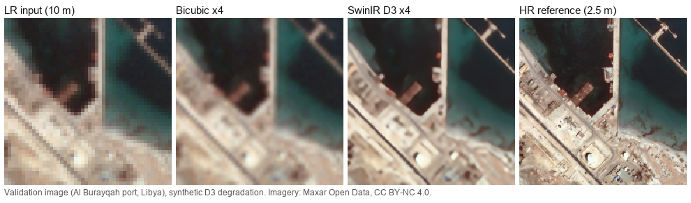
  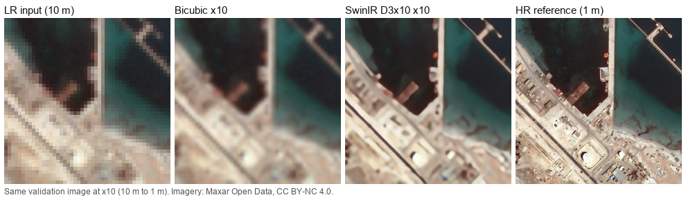
  <br><sub>A validation image of the oil port of Al Burayqah, Libya (harbour basin, jetty and quay). Top: ×4 with the D3 model. Bottom: ×10 with the D3x10 model. The LR inputs are synthetic, so the HR reference exists. Imagery: Maxar Open Data, CC BY-NC 4.0.</sub>
</p>

## Marine gallery
**Validation images.** These have a synthetic LR input, so the HR reference exists. Each crop is 48 × 48 LR pixels (480 m). The models are the best D3 (×4) and D3x10 (×10) checkpoints.

<p align="center">
  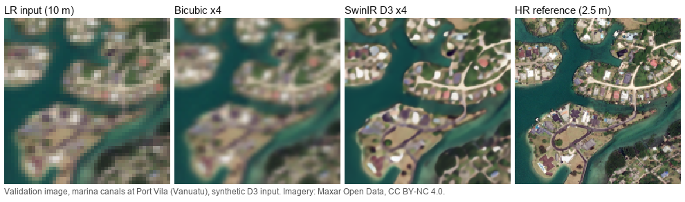
  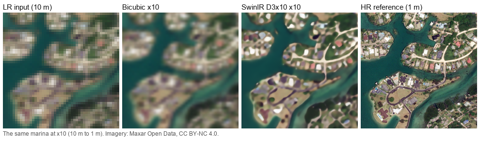
  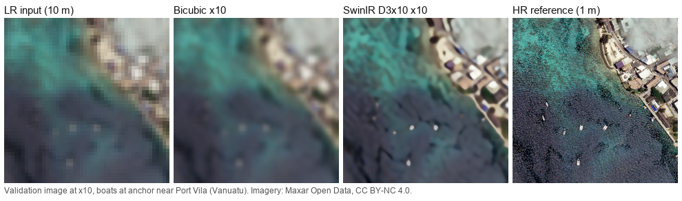
  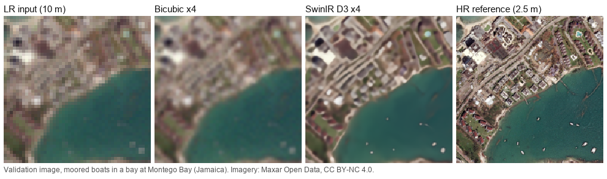
  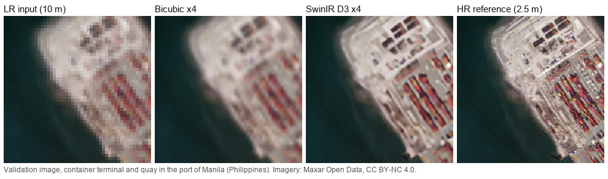
  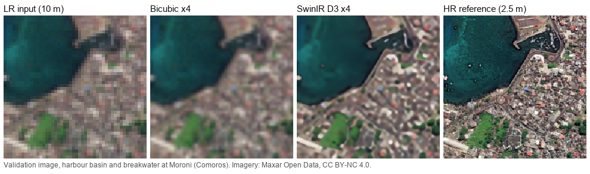
  <br><sub>Imagery: Maxar Open Data, CC BY-NC 4.0.</sub>
</p>

**Real Sentinel-2 ports.** These are real 10 m inputs, so no high-resolution reference exists and the added detail is predicted.

<p align="center">
  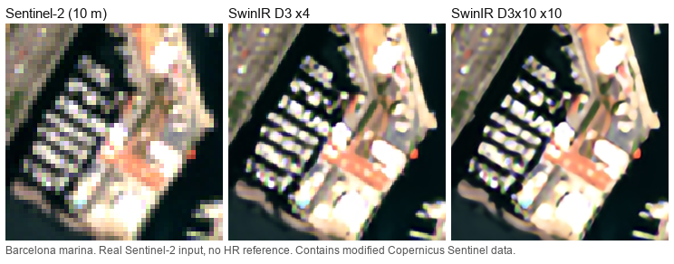
  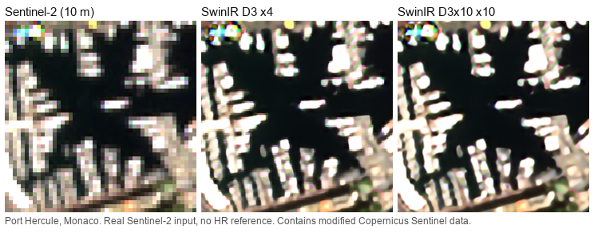
  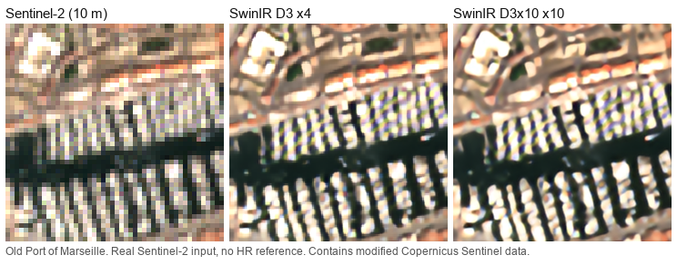
  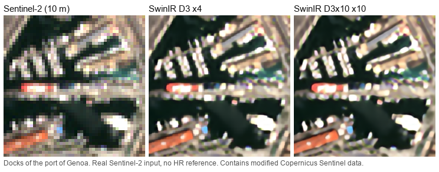
  <br><sub>Contains modified Copernicus Sentinel data.</sub>
</p>

## Repository layout
```
dataset/                 1. Data preparation
  src/  scripts/         source intake, D1/D2/D3 recipes, release build, uint8 release,
  configs/ tests/        loaders (MaritimeUint8Dataset), Sentinel-2 inputs
  d3x10/                 build, Jev-based rejection and manual restore of the x10 dataset
quality_check/           2. Jev check (TypeSafe Jev): judge, decide, contact sheets, thesis tables
  decisions/rules_v5/    final policy and the list of the 1,123 removed tiles
training/                3. Training (SwinIR from scratch, 100k updates)
  x4/                    D1, D2, D3: source/ (research, vendor, tests), ops/ (Slurm)
  x10/                   D3x10:      source/ (research, vendor),        ops/ (Slurm), tests/
evaluation/              4. Validation and prediction
  predict.py             super-resolve any RGB image with a released model
  comparisons/           Sentinel-2 and SkySat comparisons used in the thesis
  analysis/              bootstrap intervals, per-scene and per-site tables
docs/images/             the images in this README (gallery/: the marine gallery)
release/                 SHA256SUMS and notes for the weights release
```

## Installation
Python 3.10 matches the training runs.

```bash
git clone https://github.com/papaikos/Athanasios-Papazikos-Master-thesis-super-resolution-.git
cd Athanasios-Papazikos-Master-thesis-super-resolution-
python -m venv .venv && source .venv/bin/activate
pip install -r requirements.txt
```

| File | For |
|---|---|
| `requirements.txt` | training, evaluation, `predict.py`, analysis |
| `requirements-dataset.txt` | building the dataset (Earth Engine, Google Cloud Storage, rasterio, …) |
| `quality_check/requirements.txt` | the Jev check |
| `training/x4/ops/requirements-lock-d2.txt` | exact `pip freeze` of the cluster runs (torch 2.5.1 + CUDA 12.4) |

Settings live in environment variables, not in the code. Copy `.env.example` to `.env`, fill in what you need, then load it:

```bash
cp .env.example .env
set -a; source .env; set +a
```

## Pre-trained weights
The eight checkpoints (best and final of each run) are not in git. They are published as the GitHub Release [`weights-v1.0`](https://github.com/papaikos/Athanasios-Papazikos-Master-thesis-super-resolution-/releases/tag/weights-v1.0). Each file is a plain PyTorch `state_dict`, about 68 MB (×4) or 71 MB (×10).

| File | Model |
|---|---|
| `swinir_x4_D1_best_step84000.pth` / `swinir_x4_D1_final_step100000.pth` | D1 ×4 |
| `swinir_x4_D2_best_step90000.pth` / `swinir_x4_D2_final_step100000.pth` | D2 ×4 |
| `swinir_x4_D3_best_step82000.pth` / `swinir_x4_D3_final_step100000.pth` | D3 ×4 |
| `swinir_x10_D3x10_best_step72000.pth` / `swinir_x10_D3x10_final_step100000.pth` | D3x10 ×10 |

Download all of them with the GitHub CLI and check them:

```bash
gh release download weights-v1.0 -R papaikos/Athanasios-Papazikos-Master-thesis-super-resolution- -D weights
cd weights && sha256sum -c SHA256SUMS
```

Or download one file:

```bash
curl -L -o weights/swinir_x4_D3_best_step82000.pth https://github.com/papaikos/Athanasios-Papazikos-Master-thesis-super-resolution-/releases/download/weights-v1.0/swinir_x4_D3_best_step82000.pth
```

## Pipeline

### 1. Data preparation (`dataset/`)
`dataset/` holds the parts of the dataset package that the final release used. Run it from that folder with `PYTHONPATH` set to it. Imports look like `from src.maritime_uint8_dataset import MaritimeUint8Dataset`.

- **Source intake** (`scripts/maritime_maxar_intake.py`, `maritime_earthview_intake.py`, `maritime_planet_intake.py`, `maritime_noaa_intake.py`, `maritime_academic_raster_intake.py`, and the readers in `src/maritime_*_source.py`). These read the original Maxar Open Data, EarthView, aerial and SkySat pixels for the selected tiles. They need your own Google Cloud project, Earth Engine access and buckets (`GCP_PROJECT`, `GCS_BUCKET`, `GCS_PILOT_BUCKET`).
- **Release** (`maritime_ultimate_select.py`, `maritime_release_select.py`, `maritime_release_build.py`, `maritime_ultimate_release.py`, `maritime_uint8_release.py`). These choose the final tiles and splits, apply the D1/D2/D3 recipes from `src/maritime_recipes.py`, and write uint8 TAR shards with manifests.
- **Loading.** `src/maritime_uint8_dataset.py` returns `lr [N,3,128,128]` and `hr [N,3,512,512]`, already converted to float RGB in [0, 1]. Do not divide by 255 again.
- **Sentinel-2 inputs** (`scripts/acquire_sentinel_examples.py`, `acquire_sentinel30_examples.py`). These download the real Sentinel-2 port scenes used in the comparisons.
- **Tests.** Run `pytest dataset/tests`.

The earlier pilots and the candidate screening and review tools are not in the current tree. They are in the git history (commit `54972b9`).

### 2. Jev check (`quality_check/`)
Set `TYPESAFE_API_KEY` in the environment; the key is never written into a file or a log.

```bash
cd quality_check
python typesafe_image_filter.py judge --run-name full_mother --dataset-dir "$MARITIME_DATA_ROOT/Mother"
python typesafe_image_filter.py decide --run-dir runs/<run folder> --name rules_v5
python extract_metadata.py "$MARITIME_DATA_ROOT/Mother"   # per-tile metadata table
python thesis_report.py decisions/<folder>      # master table, tables and figures
```
`decisions/rules_v5/` has the final policy: remove a tile when no-data > 0.70, seams > 0.60, colour artefacts > 0.75, or P(clouds over half) ≥ 0.50. It also has the 1,211 rule removals, the 88 tiles restored after manual review, and the final list of 1,123. `python test_filter_offline.py` checks the whole flow with a mocked API, at no cost.

### 3. The ×10 dataset (`dataset/d3x10/`)
```bash
cd dataset/d3x10
python build_d3x10.py build  --out Maritime_D3x10_1m10m --workers 8
python build_d3x10.py verify --out Maritime_D3x10_1m10m --run-dir runs/<run>
python reject_d3x10.py --data Maritime_D3x10_1m10m
python restore_d3x10.py --data Maritime_D3x10_1m10m --list rejected/manual_restore_list.txt --full-run runs/<full run>
```
The build is deterministic: a rebuild gives identical bytes. See [`dataset/d3x10/README.md`](dataset/d3x10/README.md).

### 4. Training (`training/`)
The runs were chained Slurm jobs. Each job resumed from a verified checkpoint, trained for up to 5.25 h, paused, and submitted exactly one successor. The steps:

1. Copy `training/x4` (or `training/x10`) to a run folder `$PROJECT_DIR` on the cluster. For x4, also copy or link `dataset/` to `$PROJECT_DIR/science`.
2. Set `PROJECT_DIR`, `SCRATCH_DIR` and, for x4, `MARITIME_DATASET=d1|d2|d3` (for x10, `DATA_DIR`).
3. Build the pinned environment with `ops/setup_env.sh`.
4. **x4:** stage the dataset in `$SCRATCH_DIR/datasets`. Write `inputs/run-control.json` (see `inputs/run-control.example.json`) and the staging receipt that `ops/preflight_inputs.py` checks. Then run `python ops/submit_initial.py`. The first job runs the tests and the data audit (`python -m research.data_audit`), then trains.
5. **x10:** run `sbatch ops/audit.sbatch` (data audit and index), then `sbatch ops/benchmark.sbatch` (throughput check), then `python ops/submit_initial.py`.

The core training command, without the Slurm wrapper:
```bash
cd training/x4/source && export PYTHONPATH="$PWD:$PWD/../../../dataset" MARITIME_DATASET=d3
python -m research.train --storage-backend filesystem --data-root "$SCRATCH_DIR/datasets" \
  --run-dir "$SCRATCH_DIR/run" --durable-root "$PROJECT_DIR/results" \
  --control "$PROJECT_DIR/inputs/run-control.json" --source-root ../../../dataset \
  --model-source vendor/network_swinir.py --audit "$PROJECT_DIR/inputs/data-audit.json" \
  --config research/configs/d3_swinir_100k.yaml --checkpoint-retention best-latest
```
`pytest training/x4/source/tests` and `pytest training/x10/tests` run the CPU tests.

Notes:
- D1, D2 and D3 now share one code base. The thesis runs each used a frozen copy, and those copies differed only in the dataset name and recipe, which `MARITIME_DATASET` now selects.
- D3 originally ran with an earlier Google Cloud-only version of the same trainer; its model and schedule were identical.
- The configuration is frozen: `research/model_factory.py` rejects any YAML that differs from the thesis protocol. The SwinIR source is pinned by SHA-256.

### 5. Validation and prediction (`evaluation/`)
Validation is part of training. Every 2,000 updates the trainer scores all 115 validation images (PSNR, SSIM, LPIPS) and keeps the best checkpoint by PSNR. To super-resolve your own image with a released model:

```bash
python evaluation/predict.py --weights weights/swinir_x4_D3_best_step82000.pth --scale 4 \
  --input sentinel2_rgb.png --output sr_x4.png
python evaluation/predict.py --weights weights/swinir_x10_D3x10_best_step72000.pth --scale 10 \
  --input sentinel2_rgb.png --output sr_x10.png
```
The input is an 8-bit RGB image (for example a Sentinel-2 TCI crop at 10 m) or a `(3, H, W)` float `.npy` in [0, 1]. Inference is the same as in the thesis: full frame, FP32, no tiling. On the Piraeus scene, `predict.py` reproduces the archived D3 prediction to within 1e-6.

`evaluation/comparisons/` holds the scripts that produced the thesis comparisons: 20 Sentinel-2 port scenes and 10 SkySat scenes with synthetic ×4/×10 inputs, for D1, D2, D3 and D3x10. They expect a run archive folder (`RUN_ARCHIVE`, `D3_ARCHIVE`). `evaluation/analysis/` rebuilds the thesis tables from those archives (`MARITIME_ARCHIVE_ROOT`). See [`evaluation/README.md`](evaluation/README.md).

## Data availability and licences
- **Dataset.** The dataset (about 290 GB of TAR shards and GeoTIFFs) is not part of this repository. The code above shows how the release was built from the original sources. Rerunning it needs your own cloud access and the candidate lists from the earlier screening steps. Each tile keeps its source's licence in its provenance record. Examples: Maxar Open Data is CC BY-NC 4.0, and SkySat imagery is under Planet's terms.
- **Weights.** The model weights are released for research use. They were trained on that data, so the data licences still apply.
- **Code.** The code is under the [Apache 2.0 licence](LICENSE). SwinIR (`training/*/source/vendor/network_swinir.py`) is © Jingyun Liang, Apache 2.0 (see `SwinIR-LICENSE` next to it).
- **Not included.** The thesis text is not included.
